# Automação de Comprovantes de Pagamento | ETL & RPA

**Estudo de caso: engenharia de dados, validação financeira e automação de documentos**

`Power Query (M)` · `Power Apps` · `Power Automate Cloud` · `Power Automate Desktop` · `SharePoint` · `VBA`

## Interface da solução

A aplicação concentra importação, revisão das bases, execução, consulta de históricos e orientação ao usuário. As telas abaixo usam dados fictícios.

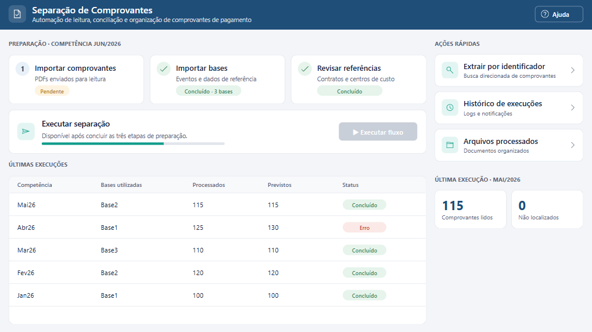

<details>
<summary>Ver funcionalidade de extração específica por identificador</summary>

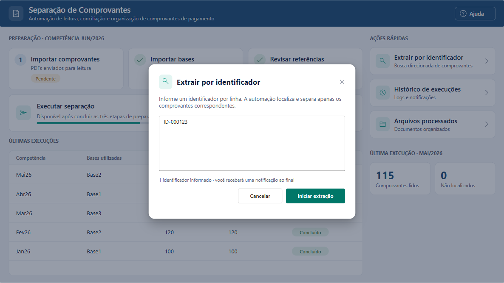

</details>

## Visão geral

O projeto foi desenvolvido para reduzir o esforço manual de identificação, validação e classificação de comprovantes de pagamento. Uma interface em Power Apps centraliza a importação dos arquivos, a atualização das bases de apoio, o acionamento dos processos e a consulta de históricos. Consultas em Power Query tratam diferentes estruturas de comprovantes e consolidam informações necessárias à automação. Power Automate Cloud coordena as integrações e a execução; Power Automate Desktop processa e organiza os documentos.

A entrega incluiu manual do usuário e vídeos de treinamento para cada etapa, além de notificações automáticas de sucesso e erro ao final de cada execução.

### Resultados reportados no projeto

| Indicador | Resultado |
|---|---:|
| Economia operacional mensal | **81,46 horas** |
| Ganho de produtividade reportado | **99,39%** |

## Arquitetura de ponta a ponta

> **Diagrama lógico simplificado:** mostra dependências entre os componentes e não equivale à sequência exata de execução de cada ação Cloud ou Desktop.

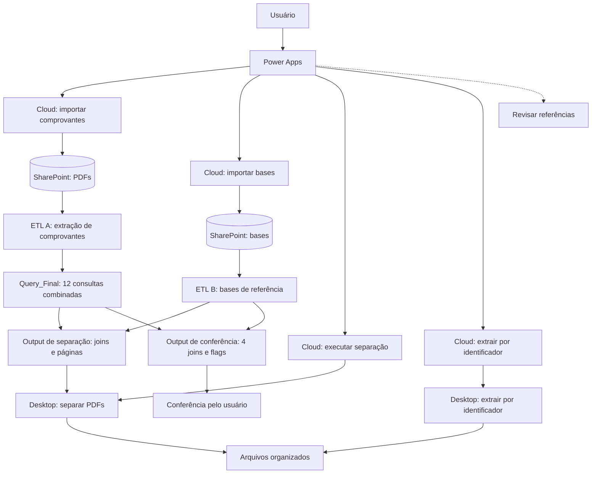

**Duas saídas com finalidades diferentes:** a saída de separação prepara arquivo e páginas para o robô; a saída de conferência mantém indicadores de existência e correspondência para revisão dos eventos de pagamento. A primeira aplica filtros e não substitui o relatório de exceções da segunda. Consulte [Arquitetura](docs/arquitetura.md) e [Pipeline de dados](docs/pipeline-de-dados.md).

## Funcionalidades da interface

- **Etapas de preparação:** importar comprovantes, importar bases e revisar referências (contratos e centros de custo), cada uma com seu status.
- **Executar separação:** fica habilitada só depois das três etapas, com indicador de progresso.
- **Últimas execuções:** competência, bases utilizadas, documentos processados e previstos, e status.
- **Extração por identificador:** aciona uma execução direcionada para os identificadores informados, um por linha.
- **Históricos:** acesso ao histórico de execuções e aos arquivos processados.
- **Última execução:** comprovantes lidos e não localizados na competência mais recente.
- **Ajuda:** orientação operacional e materiais de treinamento.

<details>
<summary>Ver manual do usuário (recriação ilustrativa em SharePoint, 5 partes)</summary>

**Manual — página inicial**

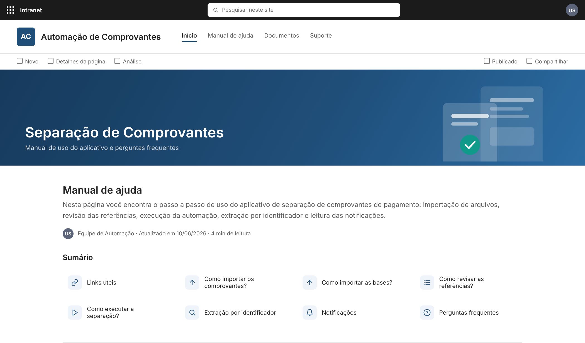

**Manual — links úteis e importação de comprovantes**

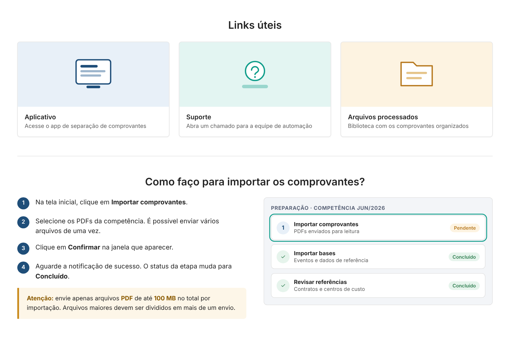

**Manual — vídeos de apoio**

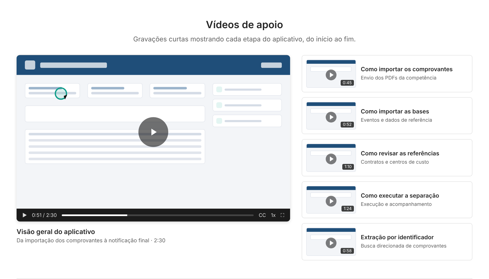

**Manual — notificações de sucesso e erro**

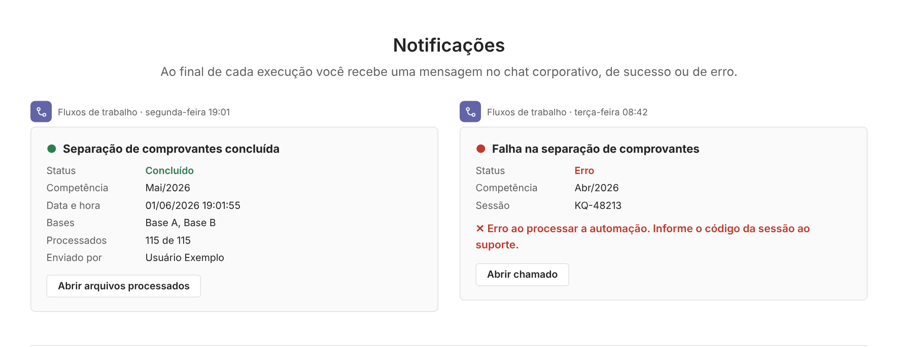

**Manual — perguntas frequentes**

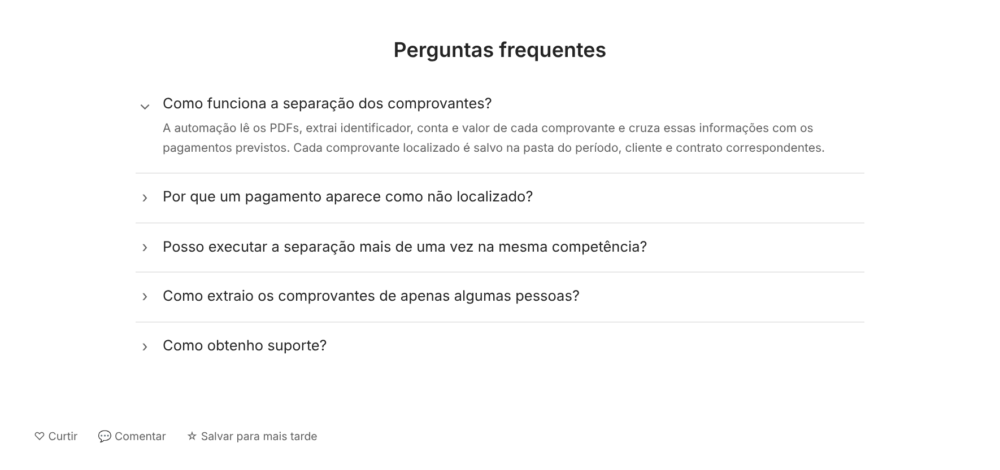

</details>

## Demonstrações visuais de Power Query (dados fictícios)

As tabelas abaixo são a **saída dos exemplos deste repositório**, com dados inventados. Não são capturas da execução corporativa e não divulgam registros financeiros, dados de colaboradores ou as consultas internas.

**Extração e padronização de diferentes layouts**

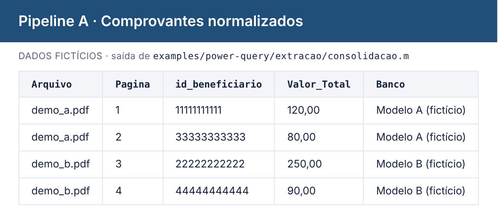

**Resultado preparado para a separação automatizada**

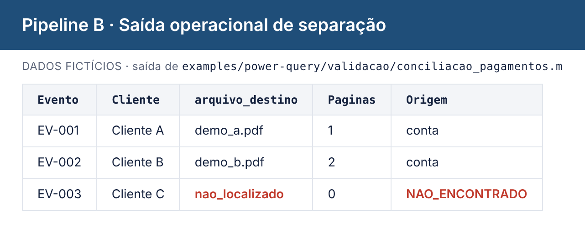

**Indicadores de conferência dos pagamentos**

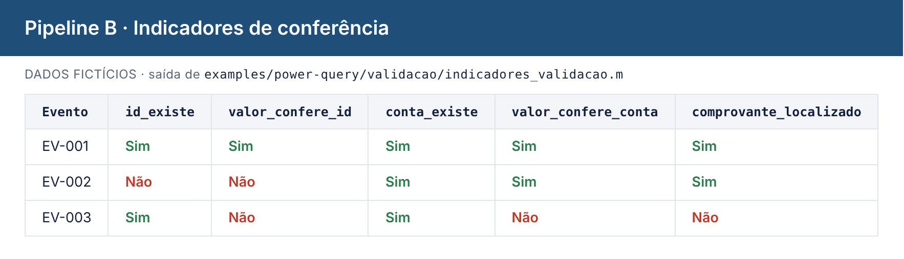

Os exemplos de Linguagem M estão em [examples/power-query/](examples/power-query/README.md).

## Engenharia de dados: dois pipelines Power Query

**Pipeline A — extração dos comprovantes.** As consultas específicas para diferentes layouts bancários extraem e normalizam informações como identificadores, valores e páginas. A consulta `Query_Final` utiliza `Table.Combine` para reunir os resultados de **12 consultas**, sem realizar os cruzamentos com os dados bancários e eventos previstos. O ambiente exibiu 36 itens no painel, incluindo parâmetros e auxiliares; não são 36 layouts distintos.

**Pipeline B — cruzamento e validação.** Recebe dados bancários dos colaboradores, eventos de pagamento e referências de contrato/centro de custo, juntamente com a saída do pipeline A. Há **duas saídas**:

| Saída | Finalidade | Critérios documentados |
|---|---|---|
| **Operacional de separação** | Instruir o Desktop sobre arquivo, páginas e classificação | `identificador + Valor` ou `Agência + Conta + Valor`, priorizando o segundo quando encontrado; sem correspondência usa `nao_localizado` antes do filtro final |
| **Conferência do usuário** | Mostrar se há comprovante e se as chaves/valores conferem | Quatro verificações: identificador; identificador + Valor; Agência + Conta; Agência + Conta + Valor; indicador final de comprovante |

A saída operacional prepara ano/mês, cliente, contrato, tipo de folha, identificador e páginas agrupadas. A saída de conferência mantém indicadores como `id_existe`, `conta_existe`, `valor_confere_id`, `valor_confere_conta` e `comprovante_localizado`.

Para leitura detalhada, veja [Pipeline de dados](docs/pipeline-de-dados.md).

Um **exemplo didático independente**, sem código nem dados de produção, está em [examples/power-query/validacao/demo_cruzamento_ficticio.m](examples/power-query/validacao/demo_cruzamento_ficticio.m).

## Automações

| Camada | Fluxo | Papel |
|---|---|---|
| Cloud | Importação de comprovantes | Entrada e armazenamento de documentos |
| Cloud | Importação de bases | Entrada e atualização dos arquivos de apoio |
| Cloud | Execução da separação | Acionamento do Desktop e verificações posteriores |
| Cloud | Extração por identificador | Encaminhamento dos identificadores para o Desktop e notificações |
| Desktop | Separação de comprovantes | Tratamento operacional, validação e classificação |
| Desktop | Extração por identificador | Processamento direcionado aos identificadores solicitados |

Os fluxos são descritos por responsabilidade e padrão em [Automações](docs/automacoes.md), em vez de capturas do ambiente corporativo.

## Validações e rastreabilidade

A conciliação entre eventos e documentos considera chaves alternativas e **valor obrigatório para considerar um comprovante localizado**. A saída de conferência preserva flags para explicar divergências. Consulte [Pipeline de dados](docs/pipeline-de-dados.md).

## Destaques técnicos

- **Regra de negócio no Power Query, não no robô.** O Desktop recebe arquivo, páginas e destino já resolvidos, o que deixa a lógica legível, testável e versionável.
- **Duas chaves de correspondência com valor obrigatório.** `identificador + valor` e `agência + conta + valor`, com prioridade para a mais específica.
- **Separação entre "existe" e "valor confere".** A saída de conferência distingue "o comprovante não foi enviado" de "foi enviado com valor diferente", o que orienta a ação do usuário.
- **Interface guiada por etapas.** A execução só é liberada depois de importar comprovantes, importar bases e revisar referências, o que reduz execuções com insumos incompletos.
- **Rastreabilidade.** Cada execução tem um identificador de sessão que aparece no log e na notificação, e erros são capturados em um único ponto do fluxo.
- **Adoção pelo usuário.** Manual, vídeos curtos por etapa e notificações claras de sucesso e erro.

Limitações conhecidas e evoluções possíveis estão no final de [Pipeline de dados](docs/pipeline-de-dados.md).

## Estrutura do repositório

```text
separacao-comprovantes/
├── README.md
├── docs/                    # Arquitetura e documentação técnica
├── assets/images/
│   ├── app/                 # Power Apps
│   ├── manual/              # Manual de ajuda recriado (5 partes)
│   └── power-query/         # Saídas dos exemplos (dados fictícios)
└── examples/power-query/
    ├── funcoes/             # Busca parametrizada
    ├── extracao/            # Modelos e consolidação
    ├── validacao/           # Conciliação e indicadores
    └── README.md            # Instruções de execução
```

## Confidencialidade e autoria

Este repositório apresenta um estudo de caso profissional acompanhado de exemplos independentes com dados fictícios. As consultas demonstrativas não correspondem aos códigos de produção. A interface e o manual mostrados são recriações com dados inventados, e os fluxos são descritos sem capturas do ambiente corporativo. Não são disponibilizados documentos financeiros reais, credenciais, exportações de soluções ou bases de colaboradores.

**Desenvolvimento:** Mylenna Duarte · [GitHub](https://github.com/Mylenna16)
