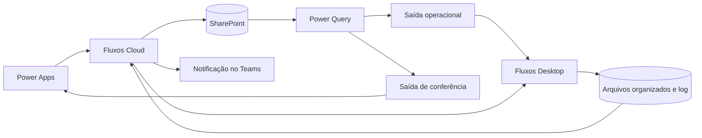

# Arquitetura

## Visão geral

A solução separa três responsabilidades: interface e orquestração (Power Apps e Power Automate Cloud), processamento de dados (Power Query) e automação de documentos (Power Automate Desktop). O SharePoint é o ponto de troca entre elas: recebe os PDFs e as bases, serve de origem para as consultas e guarda saídas e histórico.

## Componentes

| Camada | Componente | Responsabilidade |
|---|---|---|
| Interface | Power Apps (canvas) | Importar comprovantes e bases, revisar referências, acionar execuções, consultar histórico e ajuda |
| Orquestração | 4 fluxos Cloud | Receber arquivos, atualizar bases, acionar o Desktop, ler status e notificar |
| Armazenamento | SharePoint | Bibliotecas de comprovantes, bases de referência, saídas e logs de execução |
| Dados | Power Query (2 pipelines) | Extrair, padronizar, cruzar e validar |
| Automação | 2 fluxos Desktop | Separar PDFs por página e organizar pastas; extrair documentos por identificador |

## Diagrama de dependências

## Por que essa divisão

- A regra de negócio fica no Power Query, onde é legível, testável e versionável (M é texto).
- O Desktop não decide nada: recebe arquivo, páginas e destino já resolvidos.
- A interface não conhece o processamento; só dispara fluxos e lê status e histórico.
- Trocar o armazenamento afetaria as conexões, não a lógica.

## Ciclo de uma execução

1. O usuário importa PDFs e bases pelo app; os fluxos Cloud gravam tudo no SharePoint.
2. O usuário revisa a lista de referências (clientes e contratos) e dispara a execução.
3. O fluxo Cloud aciona o fluxo Desktop de separação.
4. O Desktop atualiza as consultas, lê a saída operacional e separa as páginas dos PDFs nas pastas de destino.
5. O Desktop grava os arquivos e o log; o Cloud lê o status e envia um cartão no Teams.
6. O usuário consulta a saída de conferência e o histórico pelo app.

## Extração direcionada

Além da separação completa, há um caminho curto: o usuário informa uma lista de identificadores e o sistema devolve só os comprovantes correspondentes, com um resumo do que foi e do que não foi encontrado. Usa o mesmo pipeline de extração, mas um fluxo Desktop próprio.