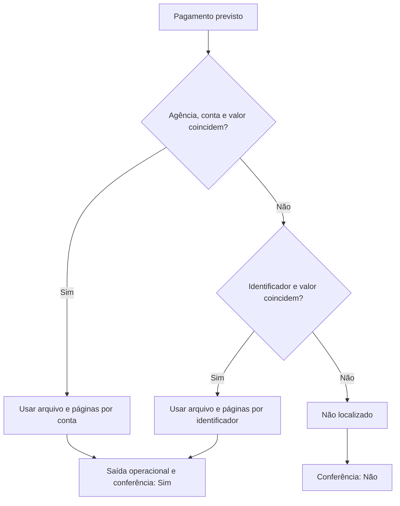

# Pipeline de dados (Power Query)

## Pipeline A — extração e padronização

Cada layout bancário tem uma consulta própria. Todas seguem o mesmo contrato de saída:

| Campo | Descrição |
|---|---|
| `arquivo` | Nome do PDF de origem |
| `pagina` | Página em que o comprovante aparece |
| `banco` | Instituição ou modelo reconhecido |
| `tipo_operacao` | Natureza do pagamento (transferência, boleto, tributo etc.) |
| `beneficiario` | Nome do recebedor |
| `id_beneficiario` | CPF ou CNPJ do recebedor |
| `agencia`, `conta` | Dados bancários do recebedor |
| `valor` | Valor total da operação |
| `data_operacao` | Data da transação |

O processo em cada consulta é: ler as páginas do PDF como tabelas de texto, localizar os rótulos relevantes com uma função de busca parametrizada (termo e delimitador), extrair os trechos, converter tipos e renomear para o contrato acima. Uma consulta final une todas as tabelas com `Table.Combine`.

Funções auxiliares:

- busca de valor por rótulo e delimitador em uma tabela de texto;
- validação de formato de CPF/CNPJ;
- teste de campo vazio tolerante a espaços e nulos.

Adicionar um layout novo significa criar uma consulta que respeite o contrato e incluí-la na união.

## Pipeline B — cruzamento e validação

### Entradas

- Pagamentos previstos: um registro por pagamento esperado, com identificador do beneficiário, agência, conta, valor e referência de classificação (período, cliente, contrato).
- Dados bancários dos beneficiários.
- Referências organizacionais: clientes, contratos e centros de custo.
- Saída do pipeline A.

### Chaves de correspondência

Dois caminhos alternativos, ambos com valor obrigatório:

1. `id_beneficiario + valor`
2. `agencia + conta + valor`

Se os dois caminhos encontram um documento, o segundo prevalece, por ser mais específico. Encontrar o identificador sem o valor correspondente não conta como localizado.

### Saída operacional

Left join a partir dos pagamentos previstos. Para cada um, resolve origem da correspondência, arquivo e páginas, monta o destino (ano/mês, cliente, contrato), higieniza nomes de pasta e agrupa as páginas em uma lista separada por vírgula. Registros sem correspondência recebem `nao_localizado` e são filtrados antes de chegar ao robô. Essa saída existe para o Desktop e não serve como relatório de pendências.

### Saída de conferência

Quatro left joins independentes, cada um gerando um indicador:

| Verificação | Indicador |
|---|---|
| Identificador aparece em algum comprovante | `id_existe` |
| Identificador e valor coincidem | `valor_confere_id` |
| Agência e conta aparecem em algum comprovante | `conta_existe` |
| Agência, conta e valor coincidem | `valor_confere_conta` |

`comprovante_localizado` é `Sim` quando `valor_confere_conta` ou `valor_confere_id` é `Sim`. Separar "existe" de "valor confere" é o que permite ao usuário distinguir "não enviaram o comprovante" de "enviaram com valor diferente".

### Diagrama da decisão

## Limitações da abordagem e evoluções

- As chaves não incluem período. Se a base de comprovantes abranger mais de uma competência, convém incluir data ou competência na chave.
- Chaves compostas não garantem unicidade. Dois comprovantes com mesmo beneficiário e valor geram duas linhas; um critério de desempate explícito (data mais próxima, por exemplo) evita isso.
- Cada layout novo exige uma consulta nova. Um catálogo de layouts com detecção automática por padrões de texto reduziria a manutenção.
- Validar o contrato de saída de cada consulta (tipos e colunas obrigatórias) antes da união evita nulos silenciosos.

## Exemplos executáveis

Os arquivos em [`../examples/power-query/`](../examples/power-query/README.md) implementam, com dados fictícios embutidos, cada uma das etapas acima.